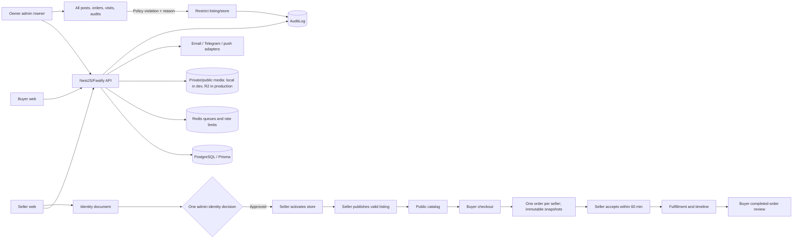

# Resaller: owner flow and launch gates

Updated: 2026-09-29. This describes the local source, not proof that production has been updated.

## Access

- Buyer/seller site: `https://resaller.uz/` after deployment; locally `http://localhost:3000/`.
- Separate admin origin: `https://admin.resaller.uz/owner` after deployment; locally `http://localhost:3001/owner`.
- The admin origin `/` returns a not-found page. The owner route is not in public navigation and has noindex headers. Its path is **not secret authentication**: server authorization, session, password, rate limit and TOTP remain mandatory. Do not share credentials in chat or Git.
- `GET /api/v1/admin/overview` requires `SUPER_ADMIN`; `GET /api/v1/admin/listings` requires `SUPER_ADMIN` or `MODERATOR` and returns 50 posts per page, including draft, active, paused, archived and restricted posts. Public catalog still shows only active listings of active, non-vacation stores.

## Core transaction and oversight

Seller creates a draft store before verification, but cannot activate it until the uploaded identity document is approved. A verified seller can activate the store without another admin decision. Publishing a listing requires an active store, seller verification, at least one image and available stock. The status moves directly to `ACTIVE` and an audit event is recorded. Admin can later restrict or restore an item with a reason. Rejecting an already-approved identity restricts all of that seller's active stores.

## Owner dashboard definitions

| Metric | Meaning |
| --- | --- |
| Today's unique browsers | Count of hashed first-party browser tokens seen today in UTC. Estimate, not identifiable people. |
| 30-day visitor-days | Sum of daily unique browsers for 30 UTC days; one returning browser can count on multiple days. |
| 30-day page views | Recorded route visits during those days. |
| Orders placed | Number of seller-split order rows, not checkout sessions and not paid transactions. |
| Completed purchases | Orders with status `COMPLETED`; payment remains outside MVP. |
| All posts / published posts | All listing statuses / only `ACTIVE` listings. |

The dashboard also shows the latest orders, listing records and audit events. It is not a complete clickstream or a real-time financial ledger. Browser analytics uses a random 30-day HttpOnly first-party token; only a keyed hash is kept in the database, not the IP or user agent for this feature. The legal privacy notice and retention schedule remain unapproved.

## Local evidence from 2026-09-29

- Prisma schema validated; migration `20260929120000_site_visits` applied to local PostgreSQL.
- API unit suite: 69 passed; the separately opted-in PostgreSQL checkout-concurrency test passed. After browser runs, the isolated test database contained visit rows and accumulated page-view counts, confirming the write path.
- Production build: web, admin, API and shared packages passed.
- Revised seller verification → store/product publication → buyer checkout → seller fulfillment → buyer review browser journey passed on desktop Chromium, Firefox, WebKit and Android with an isolated test database. The long iPhone journey is intentionally skipped on Windows; iPhone owner/admin checks passed.
- Changed-feature browser matrix: 29 passed, 1 intentional iPhone journey skip across Chromium, Firefox, WebKit, Android and iPhone. The full `pnpm check` pipeline (schema, secret scan, lint, typecheck, tests, build) passed. This is local evidence, not staging sign-off.

## Must complete before deploying this change

1. Complete full-site browser and manual accessibility/performance regression for this revision, including direct database validation of visit-count behavior and listing restoration. Approve new visual baselines separately. The changed-feature matrix passed, but the long iPhone commerce journey remains skipped on Windows.
2. Deploy a staging image from a known Git commit. Apply all 18 migrations there; back up first and rehearse restore/rollback. Verify live API/web/admin versions match that commit.
3. Rotate the previously exposed R2 credentials, connect bucket-scoped public/private R2 and run real upload/read/denial tests. Connect and verify email/Telegram/push providers and alert routing; keep secrets outside Git and deployment archives.
4. Ensure HTTPS redirect and HSTS on web/admin, private PostgreSQL/Redis, firewall, monitoring and off-host encrypted backups. Perform malware upload and SSE load checks plus a deployed-host penetration test.
5. Approve and publish legal/privacy terms, retention and visit-cookie notice; confirm support/moderation procedures, then complete the closed seller beta and fix blocking findings.

Do not treat an unlinked `/owner` URL as security, the local browser pass as staging acceptance, or order counts as payment/settlement numbers.

## 2026-09-29 deployment check

- Read-only checks of the current public hosts found `https://resaller.uz/` responding with 200, but without an HSTS header. `https://admin.resaller.uz/owner` returned 404, so the owner dashboard revision has **not** been deployed there. Do not use the live hosts as evidence for the local changes.
- The live smoke script now expects the admin root to be hidden (404), the owner entry to load at `/owner`, an admin noindex header, and anonymous denial of overview/listing endpoints. Run it against staging first, then production after deployment.
- The Cloudflare connection available to this workspace returned no `resaller.uz` zone. No zone setting, DNS, Access policy, R2 key, server file or production database was changed in this check.
- The owner elected to defer rotation of the R2 credential previously exposed in chat. It remains a security risk and must be resolved before the security gate can honestly pass. Do not copy its value into source, archives or reports.
- Legal documents remain drafts. The analytics-cookie lawful basis, notice/consent choice, retention period and cross-border processing need counsel/owner approval; a closed beta also needs real sellers and operational oversight.
